 

  

**BCA graduate from Delhi, India. I clean messy data, query it with SQL and turn it into dashboards that people can act on.**

## 🎮 Player stats

## 🗺️ Quest log

| | Quest | What I found | Stack | Status |
|---|---|---|---|---|
| 🏠 | [**MagicBricks Property Analysis**](https://github.com/LoG1604/MagicBricks-property-analysis) | Cleaned 1,820 messy listings, queried them in SQL and found that city drives price the most: Mumbai costs about 4x Lucknow per sqft | `Python` `Pandas` `DuckDB` `SQL` `Streamlit` `Plotly` | ✅ Complete |
| 👥 | [**HR Attrition Intelligence**](https://github.com/LoG1604/hr-attrition-powerbi-dashboard) | 4-page Power BI dashboard on 1,470 employees: attrition drivers, pay and satisfaction, and a flight-risk list of who to talk to first | `Power BI` | ✅ Complete |
| 📉 | [**Churn Intelligence**](https://github.com/LoG1604/churn-intelligence) | RFM features, XGBoost churn model, SHAP explanations and KMeans customer segments on the Online Retail dataset | `Python` `DuckDB` `SQL` `XGBoost` `SHAP` `Streamlit` | 🔄 In progress |

## 🎒 Inventory

 

**Side skills:** web dev with React and Node.js

## 🎯 Current objective

- 📚 Working through a data science course
- 🔨 Finishing the Churn Intelligence dashboard
- 🔭 Next up: a job market intelligence tool
- 🎧 Off the clock: music and gaming

## 🐍 Snake mini-game

My contribution graph, eaten by a snake. It regenerates every 12 hours.

  <picture>
    <source media="(prefers-color-scheme: dark)" srcset="https://raw.githubusercontent.com/LoG1604/LoG1604/output/github-snake.svg"/>
    <source media="(prefers-color-scheme: light)" srcset="https://raw.githubusercontent.com/LoG1604/LoG1604/output/github-snake-light.svg"/>
    
  </picture>

 

